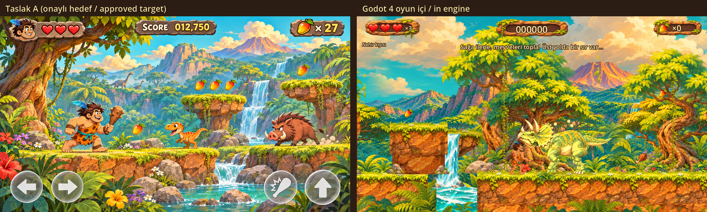

# Dino Hop!

Türkçe / English · Godot 4 (4.7.2 ile doğrulandı) · GDScript · 2D platform macerası

GitHub: https://github.com/07erkanoz/dino-hopo

## Güncel durum: oynanabilir Bölüm 01 (Taslak A yönü)

Prehistorik 2 tarzında, baştan sona oynanabilir ilk bölüm: Çiçekli Vadi. Görünüm, kullanıcının seçtiği `taslaklar/taslak-a.png` yönünü izler; görseller `art/v2/` paketinden gelir. Bu bir geliştirme sürümüdür; görsel ve hareket kalitesi henüz kullanıcı onayı almadı.

- **Çağan**: `art/v2/rig/cagan` parçalarıyla Skeleton2D/Bone2D iskeleti, AnimationTree durum makinesi. Bekleme (nefes), yürüme, koşma, zıplama, düşme, iniş, sopa saldırısı, hasar, ölme ve tırmanma animasyonları var. Ayak kaymasını IK ve mesafeye bağlı adım önler. Ezilme-esneme, öne eğilme ve baş takip hareketi de var. Ayrıntı: [docs/ANIMATION.md](docs/ANIMATION.md).
- **Düşmanlar**: iskelet rigli iki tür. Küçük ceratopsian devriye gezer, uyarı verip hücum eder. Küçük pterozor uçarak dalış yapar. İkisinin de hasar ve ölme animasyonu var.
- **Hareket fiziği**: ivmelenme ve yavaşlama, yürümeden koşuya geçiş, değişken zıplama, havada kontrol, coyote time (0,1 sn), zıplama tamponu (0,12 sn), zemine yapışma ve köşe düzeltme. Hepsi `@export` olarak `scripts/player.gd` içinde.
- **Doğa**: dört katmanlı Parallax2D (gökyüzü, dağlar ve şelale, orta orman, ön plan bitkileri). Boyalı zemin, kaya sütunları, yüzen kayalar, su ve şelale gölgelendiricileri, rüzgârda sallanan bitkiler ve CanvasModulate ile sıcak ışık.
- **Oynanış**: meyve ve bonuslar (et, yumurta, kalp, yıldız, taş tablet), gizli çiçek bahçesi, bumerang, düşen kayalar, kontrol noktası, 3 kalp ve 3 can, puan sayacı. Bölüm sonunda kazanma ekranı, canlar bitince oyun bitti ve yeniden başla ekranı açılır.
- Onaylı dört kahraman seçilebilir; tek oyuncu ya da aynı ekranda iki oyuncu. Çağan dışındaki üç kahraman için henüz rig parçası yok, eski poz çizimleriyle çizilirler.



## Nasıl çalıştırılır

```bash
godot --path .              # Godot 4 açılır, F5: menü -> Tek oyuncu -> karakter seçimi -> Bölüm 01
godot --path . --editor     # düzenleyici
```

Godot komutunun adı `godot4` de olabilir. Ana sahne `scenes/main.tscn`. Önceki doğa atölyesi `scenes/nature_workspace.tscn` hâlâ ayrı açılabilir (F6).

| Kontrol | Tek oyuncu | P1 (iki oyuncu) | P2 (iki oyuncu) | Gamepad |
|---|---|---|---|---|
| Hareket | A/D veya ←/→ | A / D | ← / → | sol çubuk / yön tuşları |
| Zıplama | Boşluk, W, ↑, Z | W, Boşluk | ↑, Shift | A (alt) |
| Sopa | F, J, X, Ctrl | F | K | X (sol) veya B |
| Bumerang | G, K, C | G | L | Y (üst) veya RB |
| Sarmaşık | W/S, ↑/↓ | W / S | ↑ / ↓ | sol çubuk yukarı/aşağı |

Esc veya P: menü. R: kontrol noktasına dön. Zıplama tuşunu erken bırakınca zıplama kısa olur. İki oyunculu modda P1 gamepad 0'ı, P2 gamepad 1'i kullanır.

**Dokunmatik:** Android'de ya da dokunmatik ekranlı cihazda ekranın altında sol, sağ, vur ve zıpla tuşları çıkar (`art/v2/ui`). Bumerang tuşu bumerang bulununca görünür. Masaüstünde bu tuşlar gizlidir; ekrana ilk dokunuşta görünür. Ekran yataydır (`sensor_landscape`). Stretch ayarı `canvas_items` + `expand`, böylece 16:9, 20:9 ve 4:3 oranlarına uyar. Kod yalnız `TouchScreenButton` ve özellik etiketleri kullanır, bu yüzden iOS'a taşınabilir (iOS dışa aktarması şimdilik yok).

## Test ve doğrulama

```bash
bash tools/verify.sh            # içe aktarma + 13 test + Linux/Windows/Android dışa aktarma + çıktı kontrolü
bash tools/run_tests.sh godot   # yalnız testler (tests/*_smoke.gd ve tests/*_test.gd), kayıtlar build/logs/
bash tools/capture.sh           # ciktilar/ekran/ ekran görüntülerini yeniden üretir (görüntü sunucusu gerekir)
```

Yeni testler:
- `physics_test`: ivme ve yavaşlama, değişken zıplama, coyote time, zıplama tamponu ve `@export` değerleri.
- `animation_test`: 9 durum ve çapraz geçiş, adım sırasında ayak kayması (< 3 px), iki düşman rigi.
- `enemy_test`: düşmanın hasar alıp ölmesi ve puan vermesi.
- `score_test`: toplanan öğelerle puanın artması.
- `touch_test`: masaüstünde gizli, mobilde görünür dokunmatik tuşlar.
- `level_test`: oyuncunun fizik değerleriyle çıkışa ve bütün toplanabilirlere erişim, kazanma ekranı, can kaybı, oyun bitti ve yeniden başlama.

Eski smoke testleri de çalışır (`tests/smoke.gd` → `tests/game_smoke.gd`). `tools/capture.sh` sırayla `xvfb-run`, başsız `kwin_wayland` ya da mevcut `$DISPLAY` kullanır.

## Nasıl dışa aktarılır

Ön ayarlar `export_presets.cfg` içinde: **Linux**, **Windows Desktop**, **Android** (arm64-v8a, yatay, debug).

```bash
bash tools/verify.sh            # hepsini build/ altına üretir
# ya da tek tek:
godot --headless --path . --export-release "Linux" build/linux/dino-hop.x86_64
godot --headless --path . --export-release "Windows Desktop" build/windows/dino-hop.exe
godot --headless --path . --export-debug "Android" build/android/dino-hop.apk
```

- **Dışa aktarma şablonları**: Godot sürümüyle aynı şablonlar gerekir. `verify.sh` önce `~/.local/share/godot/export_templates/<sürüm>` klasörüne bakar. Orada yoksa şablonları bir kez proje içindeki `.cache/` klasörüne indirir (git dışında) ve Godot'u `XDG_DATA_HOME` ile o klasöre yönlendirir.
- **Android**: JDK 17 ve Android SDK (platform-tools, build-tools) kurulu olmalı, yolları Düzenleyici Ayarları > Export > Android altında girilmeli. Bunlar yoksa `verify.sh` Android'i "SKIPPED" diye açıkça yazar ama başarısız saymaz.
- **Debug imza anahtarı**: `GODOT_ANDROID_KEYSTORE_DEBUG_PATH`, `_USER` ve `_PASSWORD` ortam değişkenlerinden okunur. Verilmezse `verify.sh`, `build/android/debug.keystore` altında yerel bir debug anahtarı üretir. Depoda hiçbir anahtar ya da parola yok.
- `build/`, `.cache/` ve `.godot/` git dışındadır.

## Belgeler
[İşlem günlüğü](docs/DEVLOG.md) · [Animasyon](docs/ANIMATION.md) · [Kararlar](docs/DECISIONS.md) · [Bölümler](docs/LEVELS.md) · [Vuruş ve tepki](docs/HIT_FEEDBACK.md) · [Silahlar](docs/COMBAT.md) · [Oyun tasarımı](docs/GAME_DESIGN.md) · [Dünya](docs/WORLD.md) · [Doğa stili](docs/NATURE_STYLE.md) · [Görsel sözleşmesi](docs/ART_SPEC.md) · [Yol haritası](docs/ROADMAP.md) · [v2 görsel paketi](art/v2/README.md)

## English
Playable Level 01 (Blooming Valley) in the user's chosen Concept A direction, built from the `art/v2` pack.

- Çağan is a Skeleton2D/Bone2D rig driven by an AnimationTree state machine with cross-fades. His animations are idle (breathing), walk, run, jump, fall, land, club attack, hurt, die and climb. IK-planted, distance-driven gait keeps the feet from sliding.
- Two rigged enemies: a charging ceratopsian and a swooping pterosaur.
- Movement tuning is exported in `scripts/player.gd`: acceleration, variable jump, coyote time, jump buffer, floor snap and corner correction.
- Nature: four Parallax2D layers, painted terrain, animated water and waterfalls, wind sway.
- Pickups, a secret area, score, hearts and lives, a win screen, and game over with restart.
- Keyboard and gamepad through the InputMap. Touch buttons appear only on touch devices.
- Run with `godot --path .`. Verify and export with `bash tools/verify.sh` (Linux/Windows exports land in `build/`; Android is skipped with a clear message when no JDK/Android SDK is installed).
- Screenshots are in `ciktilar/ekran/`.
- Not yet user-approved as final art or motion.
