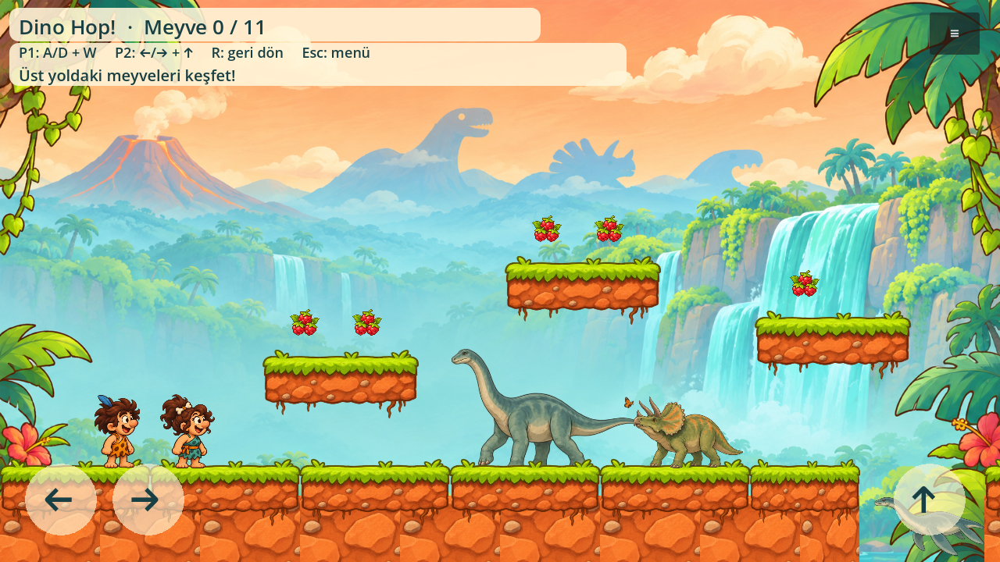
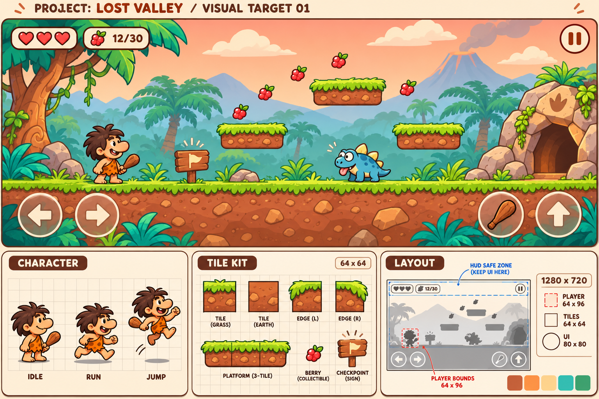

# Dino Hop!

GitHub: https://github.com/07erkanoz/dino-hopo

Türkçe / English • Godot 4.6 • GDScript • 2D cartoon co-op platformer

## Durum / Status
İlk çizim paketiyle çalışan hareket test alanı: şelaleli vadi, iki çizilmiş kahraman, platform/nesne atlası ve altı canlı. Tam bölümler, tam animasyonlar ve çevrim içi oyun henüz uygulanmadı.
Movement sandbox with the first illustrated art pack; full levels, full animation sets and online play are not implemented.

## Yeni çizimler
[Çizimlerin tamamı ve kullanım bilgileri](art/README.md) · Oyunda menüden **Çizim galerisi**.

## Çalıştırma
Godot 4.6 ile `project.godot` dosyasını açın ve F6 değil **F5** ile başlatın.
Komut satırı: `godot --path .`

- Oyuncu 1: A/D hareket, W zıplama.
- Oyuncu 2: yön tuşları; yukarı zıplama. Menüden iki oyuncu seçilir.
- Kontrolcü: sol çubuk, alt yüz düğmesi zıplama; sırasıyla cihaz 0 ve 1.
- Mobil: dokunmatik yön ve zıplama düğmeleri (tek yerel oyuncu).
- R: kontrol noktasına dön. Escape: menüye dön.
- Menü: Türkçe/English, tek/iki oyuncu.

## Belgeler
- [Oyun tasarımı](docs/GAME_DESIGN.md)
- [Bölümler](docs/LEVELS.md)
- [Kararlar](docs/DECISIONS.md)
- [İşlem günlüğü](docs/DEVLOG.md)
- [Görsel üretim kuralları](docs/ART_SPEC.md)
- [Geliştirme yol haritası](docs/ROADMAP.md)

Referans görseldeki eski “Lost Valley” başlığı geçersizdir; oyun adı **Dino Hop!**.

## Doğrulama
`godot --headless --path . --editor --import --quit`
`godot --headless --path . --script tests/smoke.gd`
`godot --headless --path . --script tests/art_smoke.gd`

Linux, Windows ve Android çıktıları için Godot export templates gerekir; Android SDK/JDK, iOS son paketlemesi için macOS/Xcode gerekir. Bu başlangıçta dağıtım paketleri üretilmedi.
