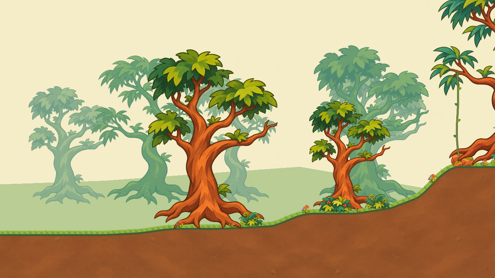
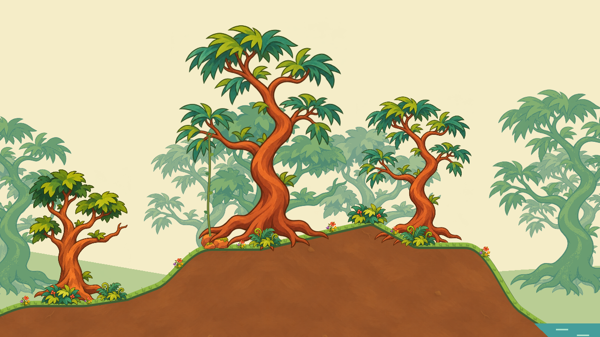
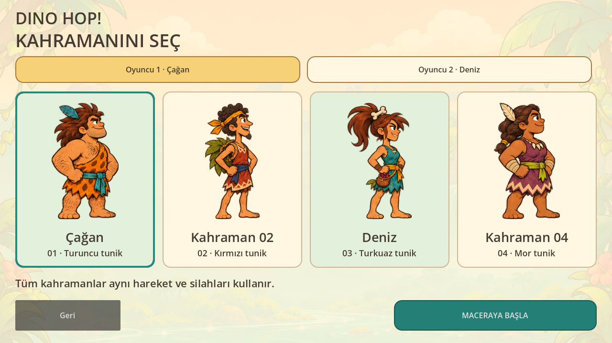

# Dino Hop!

Türkçe / English · Godot 4.6.3 · GDScript · 2D platform adventure

GitHub: https://github.com/07erkanoz/dino-hopo

## Güncel çalışma: çizgi film doğası

Kullanıcının talimatıyla **aşama2 — doğa** başladı. Harita planı üzerinde daha sade, sıcak renkli ve kahramanların çizim diliyle uyumlu bir çevre hazırlanıyor. Düşman, dövüş, görev ve yeni karakter hareketi eklenmiyor.

**F5 Doğa Atölyesi'ni açar.** Harita/Doğa düğmesi, altı bölge odağı, sürükleme/yakınlaşma ve TR/EN bulunur. H panelleri gizler; R genel görünüme döner. Şu an doğa çalışmasıdır, tamamlanmış oyun veya nihai görsel onay değildir.

[Doğa gezintisini izle](art/nature/nature-tour-01.mp4) · [Doğa stili ve kaynaklar](docs/NATURE_STYLE.md) · [Üretim sırası](docs/PRODUCTION_PLAN.md) · [Harita](docs/maps/01-map-plan.md)





Kaynaklar `art/nature/`, stil/yerleşim `world/nature/`, sahne `scenes/nature_workspace.tscn`.

```
godot --headless --path . --script tests/nature_plan_smoke.gd
godot --headless --path . --script tests/nature_style_smoke.gd
```

Aşağıdaki oyun kayıtları eski denemelerin arşividir; önce doğa aşamasını ele alıyoruz.

---

## Önceki oyun denemesi

**İlk oynanabilir dünya geliştirme sürümü.** Onaylı dört kahraman oyuna bağlı; dünya görseli kullanıcı eleştirileriyle yeniden tasarlanıyor. Tamamlanmış oyun veya nihai bölüm değildir.

[Yeni sesli vuruş/tepki kaydı](art/review/combat-hit-v3.mp4) · [Önceki hareket çalışması](art/review/motion-study-v2.mp4) · [Önceki oynanış kaydı](art/review/forest-playtest.mp4) · [Görseller](art/README.md) · [İşlem günlüğü](docs/DEVLOG.md)



## Önceki denemeyi elle açma
Godot'ta `scenes/main.tscn` dosyasını açıp F6 kullanılır. Güncel varsayılan F5 girişi harita atölyesidir; bu eski oyun menüsünü açmaz.

| Kontrol | Oyuncu 1 | Oyuncu 2 |
|---|---|---|
| Hareket | A / D | ← / → |
| Zıplama | W veya Boşluk | ↑ veya Shift |
| Sarmaşığa tırman / in | W / S | ↑ / ↓ |
| Sarmaşıktan ayrıl | Boşluk | Shift |
| Sopa | F | K |
| Bumerang | G | L |

R: kontrol noktasına dön. Esc: menü. Kontrolcü: sol çubuk, alt yüz düğmesi zıplama, sol yüz düğmesi sopa, üst yüz düğmesi bumerang. Dokunmatik cihazda yön, zıplama, sopa ve bumerang düğmeleri; sarmaşık yanında zıplamaya basılı tutarak tırmanma. Fiziksel kontrolcü/mobil cihaz doğrulaması henüz yapılmadı.

## Güncel içerik
- 01 **Çağan**, 03 **Deniz**, ayrıca ismi belirlenmemiş 02 ve04. Onaylı kaynak çizimler SHA-256 ile korunur.
- Yerel tek/iki oyuncu; her oyuncu dört kahramandan birini seçer. Aynı kahraman da seçilebilir.
- Sürekli kaydırılan5120 birimlik alan; üç parallax katmanı, bağımsız ağaçlar/bitkiler, hareketli su ve kelebekler.
- Köklü toprak ve tabana oturan kayalık yükseltiler; nehir, şelale, sarmaşık, üst keşif alanı, düşen kayalar.
- Sopa ile sersemletme; bulunarak edinilen, geri döndükçe tekrar atılan, araziye takılırsa kaybolan bumerang.
- 19 meyve, kontrol noktası ve bölüm çıkışı.
- Çağan için8 kareli gövde+sopa saldırısı; gerçek temasla4 kareli büyük dinozor tepkisi, geri itilme, darbe bulutu ve ses. Menüde ses aç/kapat. Bu tam set diğer kahraman/türler için henüz bitmedi.
- **Yeni hareket pilotu:** Çağan için8 adımlı koşu ve iniş/hazırlık; ilk büyük dinozor için8 fazlı yürüyüş, uyarılı hamle ve toparlanma. Tür ölçekleri, çarpışma,3 can ve geri savurma güncellendi. Diğer kahraman/tür animasyonları hâlâ eski deneme düzeyinde; tüm hareketler tamamlanmadı.

Henüz yapılmayanlar: tam animasyon döngüleri, tam ses/müzik tasarımı, yüzme, kanatlı dosta binme, ağ/PC-mobil co-op, kalan bölümler ve dağıtım paketleri.

## Tasarım ve kararlar
[Vuruş ve tepki](docs/HIT_FEEDBACK.md) · [Hareket çalışması](docs/ANIMATION.md) · [Karakterler](docs/CHARACTERS.md) · [Dünya](docs/WORLD.md) · [Silahlar](docs/COMBAT.md) · [Oyun tasarımı](docs/GAME_DESIGN.md) · [Bölümler](docs/LEVELS.md) · [Kararlar](docs/DECISIONS.md) · [Görsel sözleşmesi](docs/ART_SPEC.md) · [Yol haritası](docs/ROADMAP.md)

## Kontroller / Tests
```
godot --headless --path . --editor --import --quit
godot --headless --path . --script tests/smoke.gd
godot --headless --path . --script tests/art_smoke.gd
godot --headless --path . --script tests/world_smoke.gd
godot --headless --path . --script tests/motion_smoke.gd
godot --headless --path . --script tests/combat_smoke.gd
```
Grafik ekranında `godot --path . --script tests/capture_art.gd` gerçek Godot ekran görüntülerini yeniler. `tests/record_demo.gd` gerçek tuş girdileriyle kısa bir otomatik oynanış kaydı içindir, kamera ışınlamaz.

Linux/Windows/Android/iOS hedeflenir. Henüz derlenmiş platform paketleri yok. Export templates gerekir; Android için SDK/JDK; iOS son paketleme ve imzalama için Mac/Xcode gerekir.

## English
The active stage is **cartoon nature**, following the map layout. F5 opens a nature-only workspace with map/nature switching, region views, pan/zoom and TR/EN. Independent trees, source-pixel branch sockets, attached slim vines, terrain/soil, rocks, plants and water form the scenery. No gameplay actors are spawned. This is a visual study, not a finished game. The previous prototype remains archived at `scenes/main.tscn`. See `docs/NATURE_STYLE.md`.
