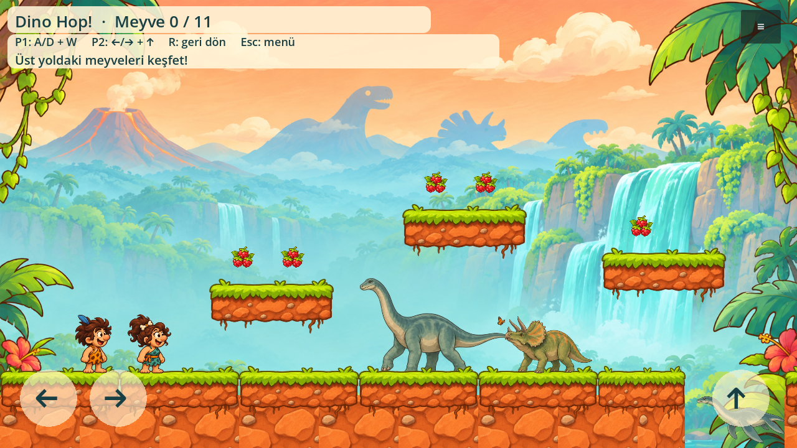
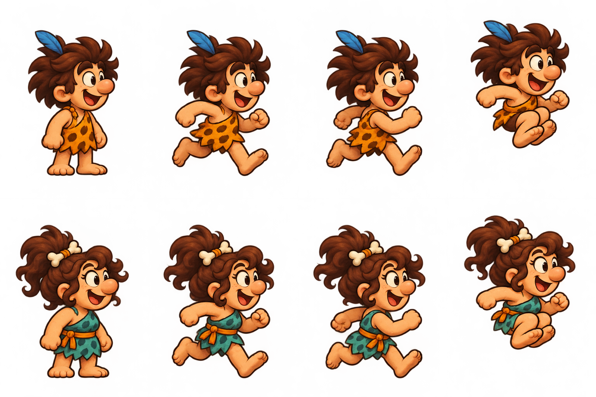
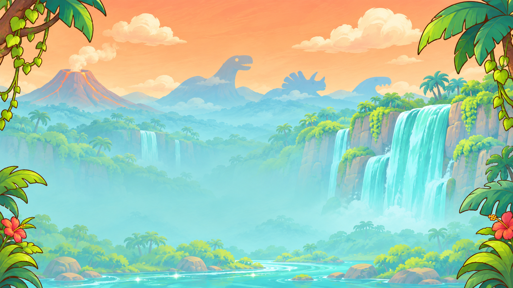
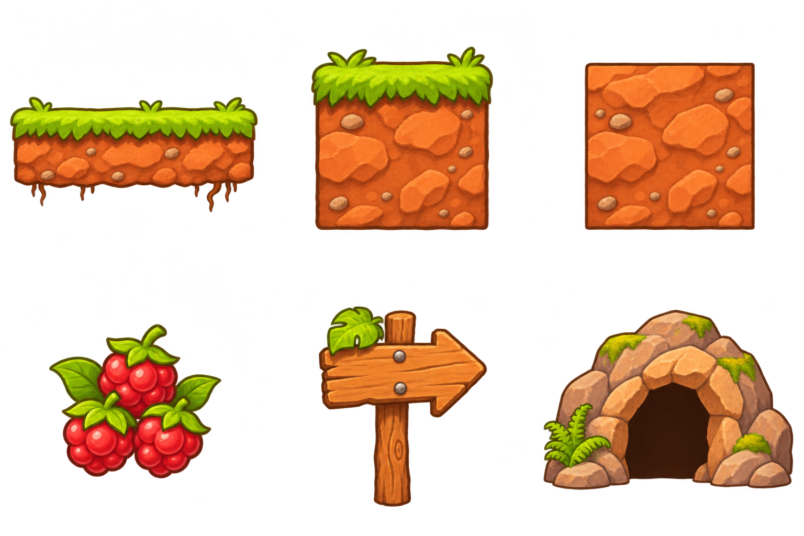

# Dino Hop! — Çizimler / Artwork

Bu klasörde kaynak PNG çizimleri, atlas koordinatları ve Godot'tan alınmış gerçek ekran görüntüleri bulunur. 2026-11-11 tarihli ilk çizim paketi.

## Oyunda yerleştirilmiş görünüm / In-engine view

Bu bir hayali oyun ekranı veya tek resim olarak sahneye yapıştırılmış bir mockup değildir. Karakterler, platformlar, meyveler, tabela, mağara ve canlılar ayrı atlas bölgelerinden Godot tarafından çizilir. Arka plan ayrı resimdir. Çizimler hareket prototipine bağlanmıştır; tam bölüm veya tamamlanmış oyun değildir.

## Kahramanlar / Heroes

4 sütun × 2 satır. Her kahramanda bekleme, iki koşu ana pozu ve zıplama pozu. Çizim sırası `art/atlas-regions.json` içinde kayıtlıdır. Kahraman adları henüz kesinleşmedi. Bunlar iki pozla gösterilen temel hareketlerdir; akıcı nihai yürüyüş/koşu için ara kareler ve ek durumlar gerekir.

## Şelaleli vadi / Waterfall valley

1672×941; 1280×720 sahneye uyarlanır. Bu sürüm tek arka plan tabakasıdır, ayrı parallax katmanları değildir.

## Çevre parçaları / Environment props

1536×1024 RGBA; 3×2 yerleşim. Sıra: yüzen platform, çimli blok, toprak blok; meyve, kontrol noktası, mağara kapısı. Kaynak panonun içinden koordinatla kullanılan ayrı şekillerdir. Tam 64×64 iç/dış köşe TileSet üretimi henüz yapılmadı; bu parçalar ızgaraya oturtularak kullanılıyor. Kaynakta şeffaf renk pikselleri bulunur; alpha destekleyen görüntüleyici kullanılmalı.

## Canlılar / Creatures — v3

İlk sürüm kullanıcı tarafından fazla yapmacık bulundu. Güncel çalışma yönü: doğal gövde oranları, küçük gözler, türlere özgü silüetler ve boyalı yüzeyler. İkinci düzeltmede atlas yerleşimi ve küçük ölçekte okunabilirlik sadeleştirildi. **Yeni görünüm kullanıcı onayı bekliyor; kesinleşmiş sayılmaz.**

Üst sıra: boynuzlu otçul, uzunboyun, stegosaur. Alt sıra: eyerli pterozor, plesiosaur, tüylü raptor. Pterozor ve plesiosaur dinozor değil; tarih öncesi canlı çeşitliliğidir. Tek poz çizimleridir; AI, yürüme animasyonu ve binme mekaniği bu paketle tamamlanmış değildir.

## Kaynak ve kullanım durumu
Bu PNG çizimleri bu proje için sohbet içindeki OpenAI görsel üretim aracıyla üretildi. Referans görsel düzenlendiğinde aynı araç kullanıldı. Mevcut oyundan karakter veya sprite kopyalanmadı. Üçüncü taraf stok görsel/lisans eklenmedi; ticari isim/marka ve nihai içerik incelemesi ayrıca yapılacak.

`review/creatures-v1-rejected.png` ve `review/creatures-natural-v2.png` tasarım geçmişidir; aktif sahne tarafından kullanılmaz. `review/*-in-engine.png` gerçek Godot ekran çıktısıdır. Ham PNG'ler yeniden boyutlandırılıp kesilmedi; atlas bölgeleri motor içinde okunur.

## Görmek ve doğrulamak
- F5 → **Çizim galerisi / Art gallery**: dört sekmede kaynak çizimleri.
- F5 → **İki oyuncu / Two players**: iki kahramanı çizimlerle deneyin.
- `godot --headless --path . --script tests/art_smoke.gd`: 20 sprite bölgesinin sınır, RGBA, içerik ve şeffaflık testi.
- Grafik ekranında `godot --path . --script tests/capture_art.gd`: dört gerçek ekran çıktısını yeniler.
