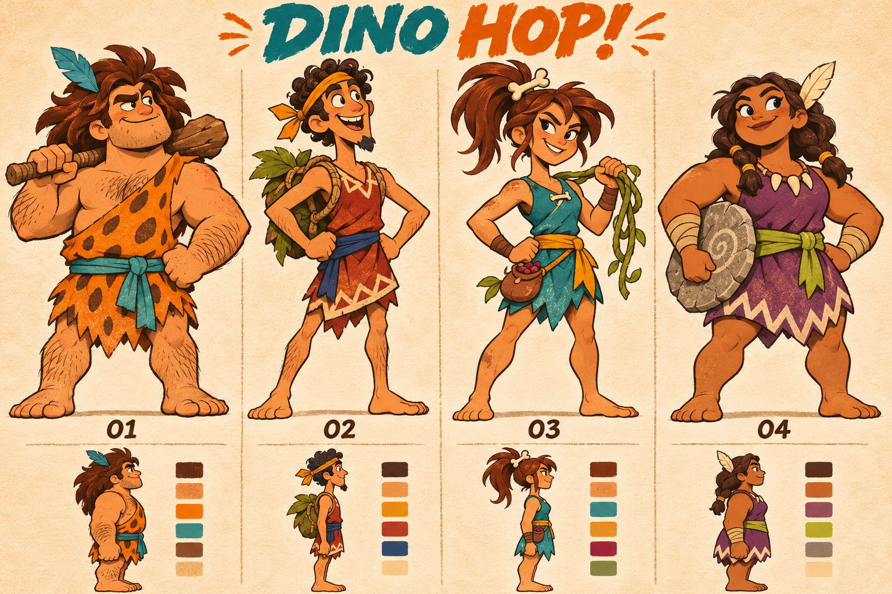
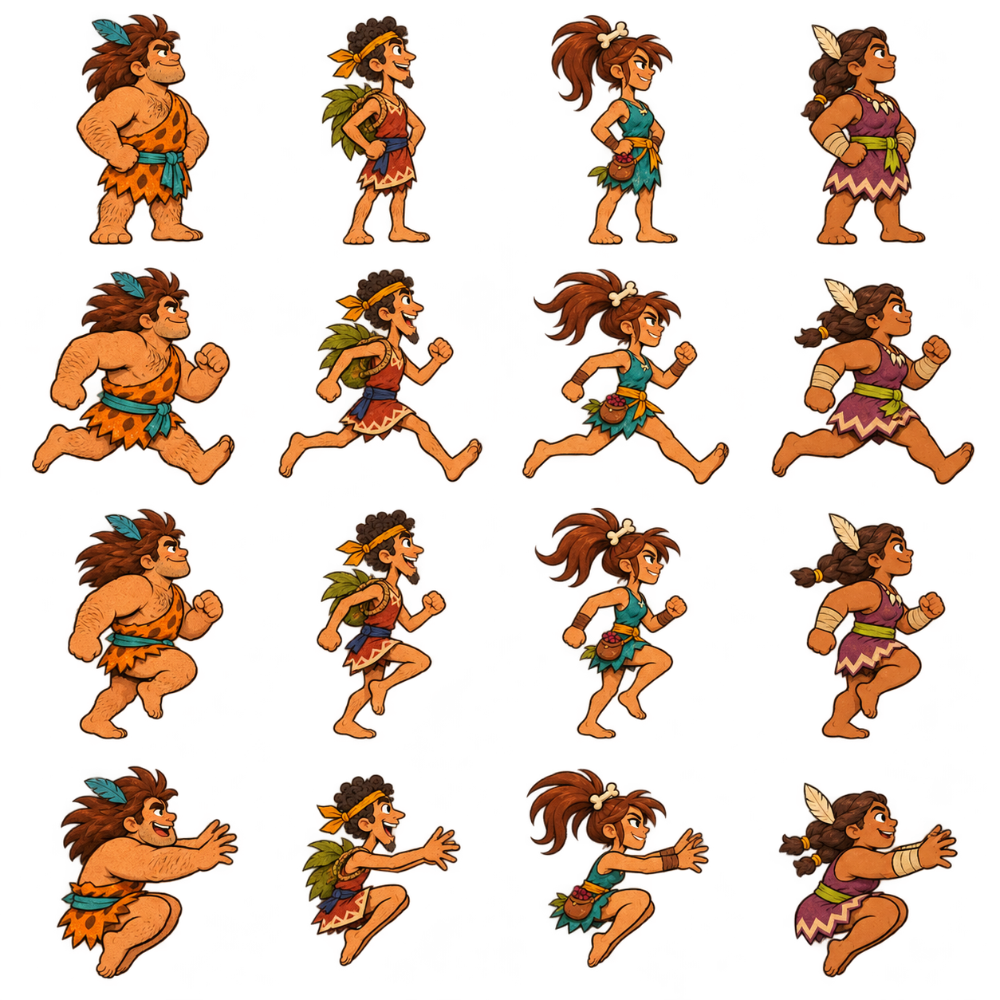
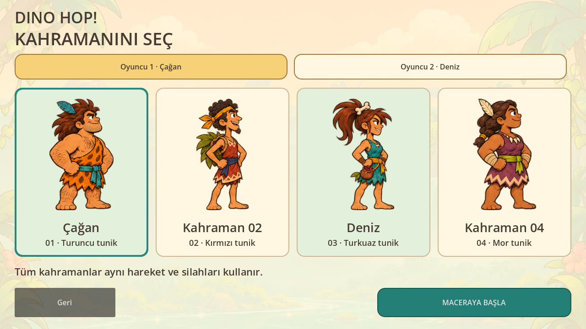
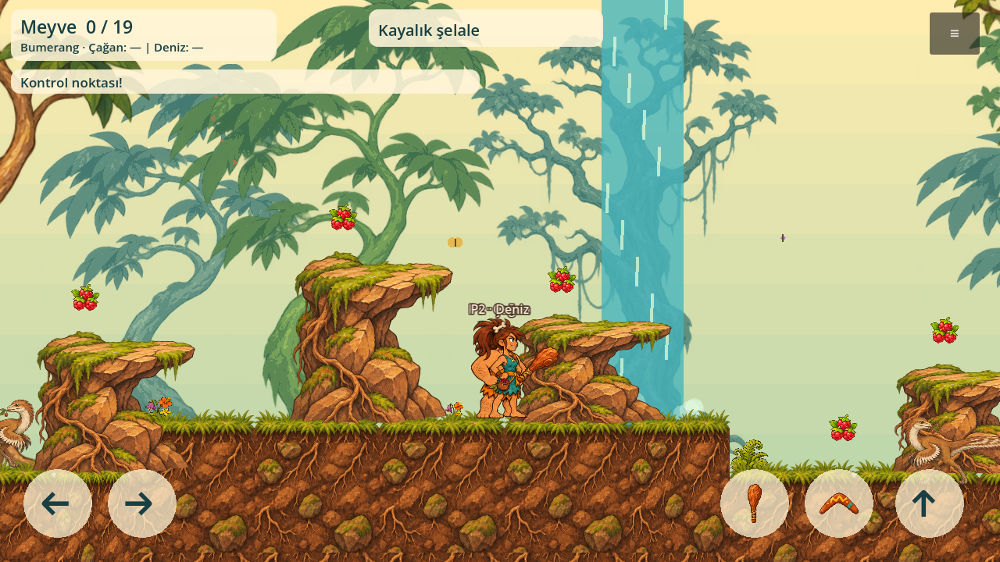
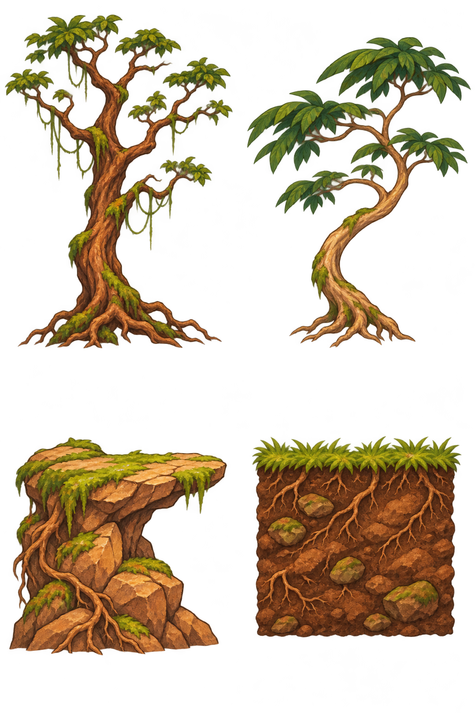
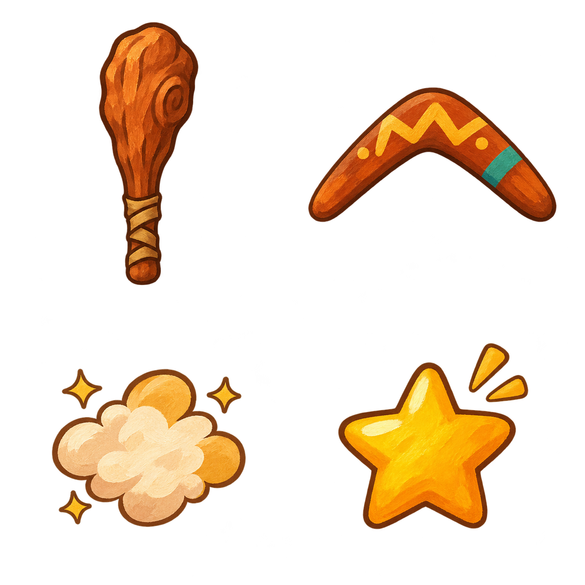
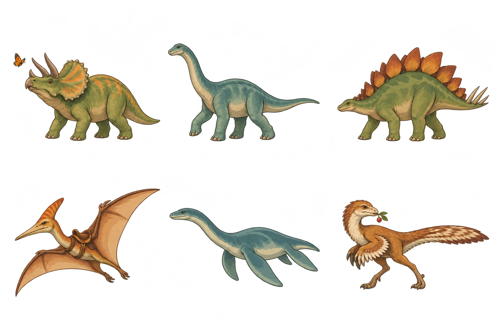
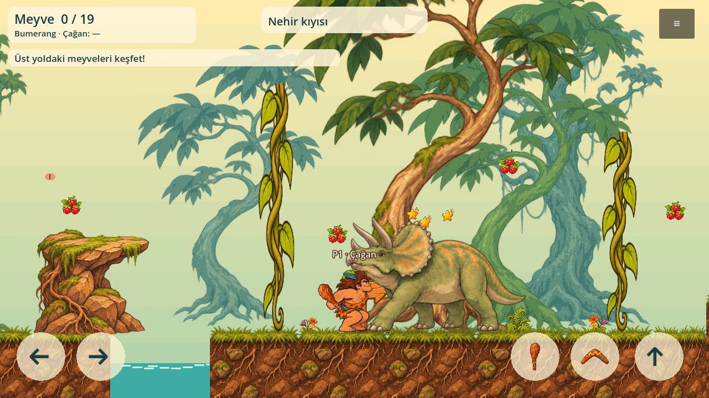
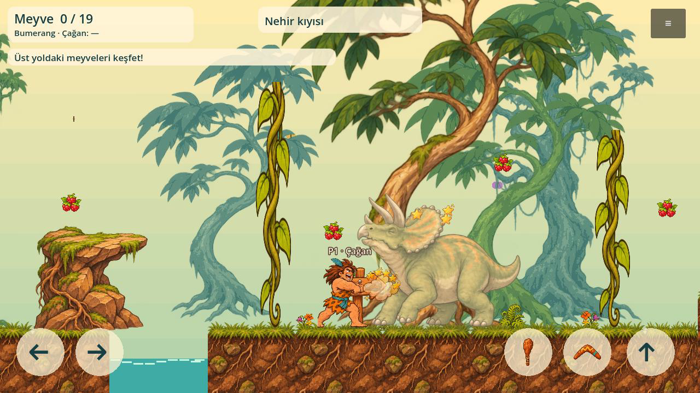
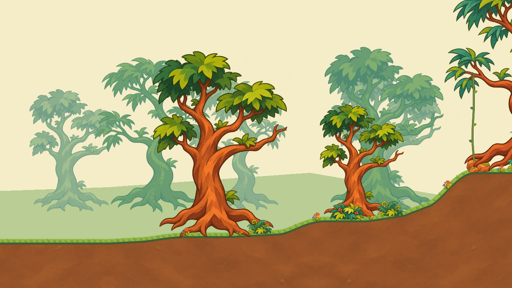

# Dino Hop! — Çizimler / Artwork

**Güncel aşama çizgi film doğasıdır.** [Yeni doğa seti ve gerçek görüntüler](../docs/NATURE_STYLE.md). [Üretim planı](../docs/PRODUCTION_PLAN.md) · [Teknik harita taslağı](../docs/maps/01-map-plan.md). Aşağıdaki oyun görselleri önceki denemeler ve kaynak arşividir.

## Onaylanan dört kahraman

01 **Çağan**, 03 **Deniz**. 02 ve04 için henüz isim seçilmedi. Kaynak pafta ve poz atlası kullanıcı tarafından onaylandı; aynı PNG'ler motor içinde kullanılır. [Karakter sözleşmesi](../docs/CHARACTERS.md).

Atlas: 4 sütun kahraman, 4 satır hareket pozu. Bunlar temel pozlardır; tüm animasyon durumlarının tamamlandığı anlamına gelmez. Kaynak hash'leri `characters/approved-sha256.json` içinde.

## Gerçek motor görüntüleri

[13 saniyelik gerçek oynanış kaydı](review/forest-playtest.mp4): Godot MovieMaker ile20fps, gerçek tuş girdileriyle kayıt. Kamera manuel ışınlanmaz. MP4 yalnız kayıt videosunun sıkıştırılmış hâlidir; üretilmiş hayali oyun videosu değildir. Görsel dünya kullanıcı değerlendirmesi ve revizyon aşamasındadır.

## Bağımsız dünya parçaları

Güncel habitat: iki farklı doğal dallanan ağaç, köklü kaya çıkıntısı, köklü toprak kesiti. Oyun ayrı düğümlerden ve üç hareket katmanından oluşur; bu atlas arka plana yapıştırılmış bir manzara değildir. Tam görsel onayı henüz verilmedi.

Sopa, bumerang, vuruş bulutu ve yıldız. Ekipmanlar kahraman resminin üstüne boyanmaz, ayrı sprite olarak takılır.

Küçük çiçekler/eğrelti/sarmaşık: `environment/jungle-modules.png` atlasından. Oradaki eski yuvarlak ağaç ve gri dekor taşı aktif sahnede kullanılmaz. Eski `environment/jungle-props.png` meyve, tabela ve mağara için kullanılır; eski turuncu blok zeminleri yeni habitatla değiştirildi.

## Canlılar

Altı tarih öncesi canlı. Pterozor/plesiosaur bilimsel olarak dinozor değildir. Dört canlı örneğinde temel fizik devriyesi ve sersemleme bağlanmıştır; her türün tam hareket/AI/animasyon seti henüz yoktur.

## Tasarım geçmişi
- `review/amazon-background-rejected.png`: kahramanlara uyumsuz bulunan ilk Amazon manzarası; kullanılmaz.
- `review/warm-forest-style-study.png`: stil araştırması; sabit oyun arka planı olarak kullanılmaz.
- `review/duo-exploration-before-four-heroes.png`, `characters/heroes-poses.png`: dört kişilik onaylı kadrodan önceki araştırmalar.
- `review/creatures-v1-rejected.png`: yapmacık bulunan oyuncak benzeri canlılar; kullanılmaz.
- `review/creatures-natural-v2.png`: atlas sınır problemi nedeniyle v3 ile değiştirildi.
- `backgrounds/waterfall-valley.png`: eski tam manzara; güncel oynanışta değil, menü dekorunda bulunur.
- `reference/visual-target-01.png`: eski Lost Valley başlıklı başlangıç panosu; güncel ad Dino Hop!.

## Kaynak ve ölçüler
PNG çizimleri bu proje için OpenAI görsel üretim aracıyla üretildi. Kahraman stili ve kompozisyon referansları aynı araçla kullanıldı. Prehistorik2 ekranı yalnız çalışma klasöründe görsel inceleme için tutuldu; depoya ve oyuna eklenmedi, kaynak sprite kopyalanmadı.

Ham PNG'ler korunur. `atlas-regions.json` motorun okuyacağı gerçek piksel bölgelerini kaydeder; alpha içeriği ölçülür. RGBA dosyalarının tam şeffaf piksellerinde görünmeyen RGB renkleri olabilir; alpha destekleyen görüntüleyici kullanılmalı.

Godot menüsünde **Çizim galerisi / Art gallery** bulunur. Doğrulama: `tests/art_smoke.gd`42 aktif sprite bölgesini ve onaylı kahraman kaynaklarının hash'lerini kontrol eder. Ticari isim/marka kontrolü henüz yapılmadı.

## Yeni hareket pilotu
[Çağan ve büyük dinozor:9 saniyelik motor kaydı](review/motion-study-v2.mp4).

Kaynaklar: `animation/cagan-locomotion-study.png` (12 kare), `animation/ceratopsian-walk-study.png` (8 kare). Onaylı pafta/atlas korunur; yeni hareketler ayrı değerlendirme aşamasında. Diğer kahramanlar ve küçük türler henüz aynı hareket düzeyine yükseltilmedi. Aktif atlas bölgesi sayısı62 oldu.

## Yeni savuruş ve darbe tepkisi
[6s sesli Godot kaydı](review/combat-hit-v3.mp4).

`animation/cagan-club-attack-study.png`:8 gövde+sopa karesi; `animation/ceratopsian-hit-study.png`:4 tepki karesi. Tam şeffaf kaynaklar, ayrı yeni hareket çalışmalarıdır; onaylı pafta kaynaklarına dokunulmadı. Yeni karelerin görsel onayı henüz yoktur. Başarısız matlı ilk sürüm yalnız `review/cagan-attack-rejected-matte.png` arşivindedir. Aktif atlas sayısı74. [Ses kaynakları](../audio/README.md), [temas sözleşmesi](../docs/HIT_FEEDBACK.md).

## Çizgi film doğası — yeni kaynaklar
`nature/cartoon-trees-01.png`, `nature/cartoon-ground-plants-01.png`, `nature/cartoon-soil-quiet-01.png`. İki ağaç, altı çevre/bitki parçası ve sade toprak dolgusu aynı palette üretildi.

Bunlar eski oyun denemesiyle karıştırılmaz. Aktif sahnede kahraman/düşman yoktur; doğa nihai onay almadan sonraki aşamalar açılmadı.
