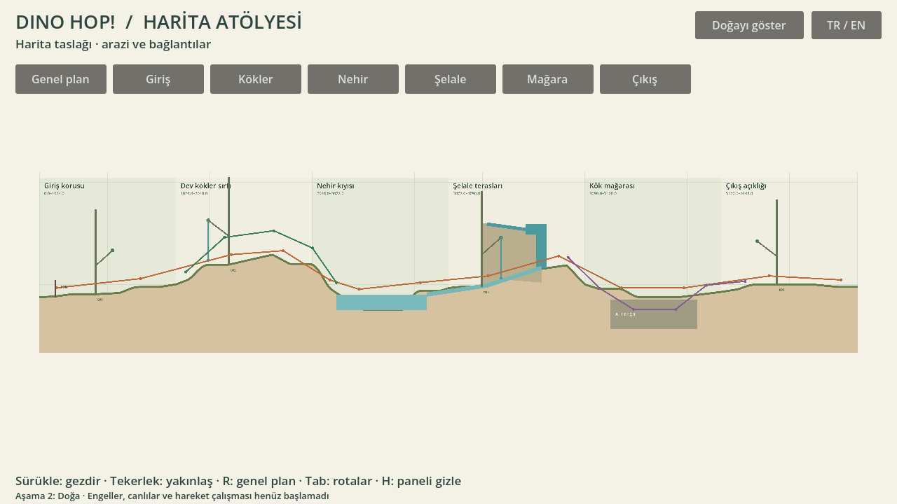
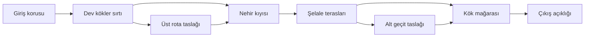

# 01 — Çiçekli Vadi harita taslağı

**Durum: harita/yerleşim taslağı.** Doğa çizimi, zorluk düzeni ve oyun bölümü tamamlanmadı. Mevcut6144×1536 ölçek ve yerleşim çalışma önerisidir.

## Genel akış

| Bölge | Yatay aralık | Haritadaki amacı |
|---|---|---|
| Giriş korusu |0–1024 | Ferah başlangıç; yoğunluk ve ölçek tanımı. |
| Dev kökler sırtı |1024–2048 | Arazi yükselişi ve üst yol bağlantısı. |
| Nehir kıyısı |2048–3072 | İki kıyı, nehir yatağı ve geçiş alanı. |
| Şelale terasları |3072–4096 | Suyun beslendiği üst eşik, düşüş, havuz ve kaya terasları. |
| Kök mağarası |4096–5120 | Alt geçit ile üst sırtın yeniden birleşmesi. |
| Çıkış açıklığı |5120–6144 | Görüşün yeniden açılması ve bölümden çıkış yönü. |

Ana rota, üst rota ve alt geçit ayrı çizgilerdir. Bunlar yalnız bağlantı planıdır; nokta nokta zıplama dizisi, tamamlanmış bulmaca veya fizik yolu anlamına gelmez. Görev/düşman konumları bu aşamada belirlenmez.

## Topoloji öncelikleri

1. İki kıyıyı ve akış yönünü birlikte düşünmek; sonradan mavi bir şerit eklememek.
2. Şelaleyi boşlukta başlatmamak; besleyen üst akış ve kaya eşiğini aynı planda göstermek.
3. Mağarayı araziye bağlı bir iç hacim olarak kurmak; ayrı bir kapı resminden ibaret bırakmamak.
4. Ağaçları yüzeye oturtmak; sarmaşıkları belirli dal yuvalarına bağlamak. Bu planda iki sarmaşık örneği var, nihai sayıları kesin değil.
5. Önce haritanın bütününü okumak, sonra her bölgeyi doğa kompozisyonuyla detaylandırmak.

## Godot'ta inceleme

F5 → Harita Atölyesi. Genel plan veya altı bölge düğmesi; sürükleyerek gezinme, tekerlekle yakınlaşma. R genel plana döner, Tab rota çizgilerini açar/kapatır, TR/EN dili değiştirir.

Çizgiler, renk alanları ve ağaç işaretleri **teknik şemadır**; oyun doğası olarak sunulmaz. Sonraki doğa aşamasında bu yerleşim için tutarlı biçim, renk, ölçü ve parça bağlantıları hazırlanır.

## Doğa aşamasındaki bağlantı ayrıntıları
Kullanıcı bu planın ardından doğaya geçilmesini istedi. Görsel doğa için ağaçların kaynak dal pikselleri ölçüldü; şemadaki yaklaşık dal offsetleri bunlarla güncellendi. Ağaç diplerine küçük zemin yükseltileri ve şelale havuzuna yüzey bağlantısı eklendi. Ana yerleşim planı korunur. [Doğa stili](../NATURE_STYLE.md).
